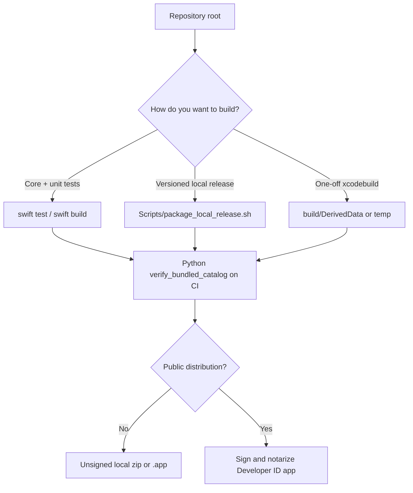

# Build guide

## Xcode app (recommended for distribution)

From the repository root:

```bash
swift test                 # Validates MisterRogersRenamerCore + tests
swift build               # Validates Swift Package (library)
swift build -c release
```

### Persistent local `.app` + zip (`build/Releases/`)

Install a versioned build under **`build/Releases/<semver>/macos-<arch>/`** (not gitignored at the README level; artifacts are gitignored — see [`build/Releases/README.md`](build/Releases/README.md)):

```bash
./Scripts/package_local_release.sh
```

Pass **`semver`** and optional **`CURRENT_PROJECT_VERSION`** to override the Xcode project values for that build only:

```bash
./Scripts/package_local_release.sh 1.0.1 2
```

### One-off `xcodebuild` (DerivedData under `build/`)

```bash
xcodebuild -project "MacApp/MisterRogersRenamer.xcodeproj" \
  -scheme MisterRogersRenamer \
  -configuration Release \
  -destination "platform=macOS" \
  -derivedDataPath "build/DerivedData" \
  build

open "build/DerivedData/Build/Products/Release/MisterRogersRenamer.app"
```

### Ephemeral DerivedData (shell temp)

```bash
DERIVED="$(mktemp -d)"
trap 'rm -rf "${DERIVED}"' EXIT
xcodebuild -project "MacApp/MisterRogersRenamer.xcodeproj" \
  -scheme MisterRogersRenamer \
  -configuration Release \
  -destination "platform=macOS" \
  -derivedDataPath "${DERIVED}" \
  build

open "${DERIVED}/Build/Products/Release/MisterRogersRenamer.app"
```

The bundled episode JSON ships inside **`MisterRogersRenamer_MisterRogersRenamerCore.bundle`** in the `.app`’s **Resources**.

## Xcode (GUI)

1. Open **`MacApp/MisterRogersRenamer.xcodeproj`** — the project links the repo-root Swift package (`Package.swift`) via a local package reference.
2. Select the **`MisterRogersRenamer`** scheme (macOS app); **`MisterRogersRenamerCore`** builds from SPM.
3. **Product → Run** (⌘R).

Alternatively, open **`Package.swift`** for SPM-only workflows (tests, **`MisterRogersRenamerCore`**); there is **no** SwiftPM executable anymore.

The window obeys the **900×600** minimum size set in [`MacApp/MisterRogersRenamer/AppEntry.swift`](MacApp/MisterRogersRenamer/AppEntry.swift).

## Build path



## Command-line options

This v1 build is GUI-only; there are **no** CLI flags. Use Preview + Rename inside the app.

## Signing and `.app` bundles

**CI and GitHub Releases** ship an **unsigned** zip containing **`MisterRogersRenamer.app`** (`ditto`). For wider distribution outside your machine, use **Signing & Capabilities** in Xcode (your Team), then **Archive**, **Developer ID**, and **notarize**.

Sandboxing is optional; if you enable **App Sandbox**, grant **User Selected File** read/write for renaming user-chosen files.

## Troubleshooting builds

- **“No such module SwiftUI”** — build for **macOS**, not Linux/Windows.  
- **Older OS** — deployment target is **macOS 12**; lower targets are unsupported.
