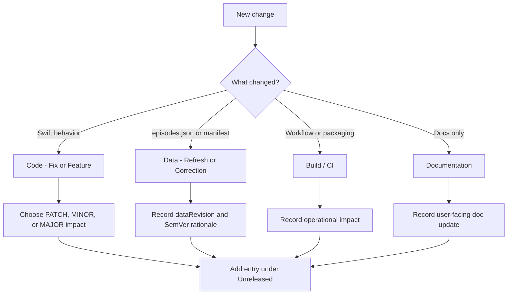

# Changelog

All notable changes to this project will be documented in this file.

The format is based on [Keep a Changelog](https://keepachangelog.com/en/1.1.0/),
and this project adheres to [Semantic Versioning](https://semver.org/spec/v2.0.0.html).

## Documentation

- [README](README.md) — features, episode data, troubleshooting
- [QUICKSTART_SWIFT](QUICKSTART_SWIFT.md) — build and run in ~2 minutes
- [BUILD_GUIDE](BUILD_GUIDE.md) — Xcode app, local releases, signing
- [TECHNICAL_DOCUMENTATION](TECHNICAL_DOCUMENTATION.md) — architecture, matching, TheTVDB client
- [RELEASING](RELEASING.md) — SemVer, bundled data, tags, GitHub Releases
- [CONTRIBUTING](CONTRIBUTING.md) — PR flow and CI expectations
- [build/Releases/README](build/Releases/README.md) — local `build/Releases/<semver>/` layout

## Change classification flow

## [Unreleased]

Work in the working tree not yet on `main` (as of 2026-06-04). Sources: `git status`, `git diff HEAD`.

### Added

- **`MacApp/MisterRogersRenamer.xcodeproj`** — macOS app target (`MisterRogersRenamer.app`) linking **`MisterRogersRenamerCore`** from repo-root **`Package.swift`**; **`@main`** in [`MacApp/MisterRogersRenamer/AppEntry.swift`](MacApp/MisterRogersRenamer/AppEntry.swift) — see [BUILD_GUIDE](BUILD_GUIDE.md).
- **`MacApp/MisterRogersRenamer/AppIcon.icon/`** — Icon Composer bundle (`icon.json`, `Assets/mark.png`, `Assets/plate.png`) for Liquid Glass app icon on Xcode 26+.
- **`Scripts/GenerateAppIconIconComposerAssets.swift`** — regenerates Icon Composer PNG layers (1024×1024).
- **`Scripts/package_local_release.sh`** — **`xcodebuild`** Release + **`ditto`** zip under **`build/Releases/<semver>/macos-<arch>/`** — see [build/Releases/README](build/Releases/README.md).
- **`build/Releases/README.md`** — documents local release directory layout (versioned folders gitignored).

### Changed

- **SwiftPM** — **`MisterRogersRenamerCore`** is a **library** product only; removed SwiftPM executable target **`MisterRogersRenamer`** ([`Package.swift`](Package.swift)). *Source: `git diff HEAD`.*
- **CI** ([`.github/workflows/ci.yml`](.github/workflows/ci.yml)) — runner **`macos-26`** (Icon Composer / Xcode 26); **`MacApp/**`** in **dorny/paths-filter** `app_code`; Release **`xcodebuild`** for **`MacApp/`** in addition to **`swift build`** / **`swift test`**; label description includes **MacApp**.
- **Release** ([`.github/workflows/release.yml`](.github/workflows/release.yml)) — ships **`MisterRogersRenamer-macos-<arch>.zip`** (unsigned **`.app`** via **`ditto`**) instead of a bare **`swift build`** executable. *Source: `git diff HEAD`.*
- **`.gitignore`** — **`MacApp/DerivedData/`**, **`build/DerivedData/`**, **`build/Releases/*/`** (keep **`build/Releases/README.md`**).
- **Docs** — [BUILD_GUIDE](BUILD_GUIDE.md), [QUICKSTART_SWIFT](QUICKSTART_SWIFT.md), [CONTRIBUTING](CONTRIBUTING.md), [RELEASING](RELEASING.md), [TECHNICAL_DOCUMENTATION](TECHNICAL_DOCUMENTATION.md) updated for Xcode app + local release workflow.

### Removed

- **`Sources/MisterRogersRenamer/`** — SwiftPM executable wrapper (entry point moved to **`MacApp/`**). *Source: `git diff HEAD`.*

---

## [1.0.0] - 2026-05-12

First numbered Swift/macOS release line for this repository. **No `v1.0.0` git tag** was present in local history at changelog authoring time; release workflow is tag-driven per [RELEASING](RELEASING.md).

Bundled catalog **dataRevision `mrn-2026-05-12`**, **`contentSha256`** `87b54ef065158001b546f0df6deb59cb40a76b89256af8020252ab5fc474d74c` (prefix **`87b54ef0`** in UI). *Source: [`episodes.manifest.json`](Sources/MisterRogersRenamerCore/Resources/episodes.manifest.json).*

### Added — Code (Features)

*Source: initial import commit `887439b` (2026-05-12).*

- **SwiftUI macOS app** (`MisterRogersRenamer` SwiftPM executable + **`MisterRogersRenamerCore`** library), minimum window **900×600**, target **macOS 12+**, Swift **5.9+** ([`Package.swift`](Package.swift)).
- **Catalog modes** — **Mister Rogers (bundled)** (4-digit production-number matching) and **Any series (TheTVDB)** (season/episode patterns in filenames).
- **File selection** — **`NSOpenPanel`** for files/folders; optional **recursive** folder scan; drag-and-drop onto drop zone.
- **Supported video extensions** — MP4, MKV, AVI, MOV, M4V, WebM, FLV, TS, MPG, MPEG.
- **Rename workflow** — **Preview** (dry run, default path) then **Rename Files**; target pattern `SxEx - {Show Title} - "Episode Title".ext` with unsafe-character stripping; **skipped** rows with reasons for collisions and permissions.
- **Undo** — **Undo Last Batch** restores prior paths when files still exist (same session).
- **Bundled matching** — `ProductionNumberExtractor` scans stems for **4-digit** values in **1…1800**, skipping **1968…2001** (year ambiguity); lookup via bundled catalog.
- **TheTVDB matching** — `SeasonEpisodeExtractor` for **S01E02**, **s1e2**, **1x02**; series id or URL parsing; episode index from aired/default English listing.
- **TheTVDB runtime** — v4 login, paged episode fetch, **Keychain** API key store (`TVDBAPIKeyStore`), optional **`TVDB_API_KEY`** env for development, disk cache under Application Support (`tvdb-<seriesId>-eng.json`).
- **Seed fallback** — if bundle missing/empty, two seed episodes (**1066**, **1067**) per [README](README.md).
- **In-app footer** — displays bundled **`dataRevision`** and short **`contentSha256`** prefix (`FooterView` / `BundledEpisodeDataManifest`).
- **Core modules** — `Episode`, `EpisodeCatalog`, `RenameViewModel`, `FileService`, `RenameService` planning/execution, views (`ContentView`, `SelectFileView`, `PreviewView`, `ResultsView`, `HeaderView`, `FooterView`, `StatusIndicator`, `DesignTokens`).

### Added — Data

*Source: commit `887439b`; manifest in repo.*

- **`Sources/MisterRogersRenamerCore/Resources/episodes.json`** — bundled Mister Rogers episode catalog (**895** productions keyed by on-screen production `id` per [README](README.md)); merged from Neighborhood Archive + TheTVDB series **77750**.
- **`Sources/MisterRogersRenamerCore/Resources/episodes.manifest.json`** — sidecar with **`dataRevision`**, **`contentSha256`**, **`tvdbSeriesId`**, **`generatedAt`** for CI, releases, and support.

### Added — Build / CI

*Source: commit `887439b`.*

- **CI** ([`.github/workflows/ci.yml`](.github/workflows/ci.yml)) — **`macos-latest`**: **`swift build`** (debug + release), **`swift test`**; **dorny/paths-filter** for bundled resources vs Swift/Scripts; optional same-repo PR labels **`bundled-data`** / **`application-code`**; **`Scripts/verify_bundled_catalog.py`** digest check; Python **`py_compile`** on `Scripts/*.py` (no network/secrets).
- **Release** ([`.github/workflows/release.yml`](.github/workflows/release.yml)) — on **`v*`** tag or **`workflow_dispatch`**: verify catalog fingerprint, **`swift build -c release`**, upload unsigned binary **`MisterRogersRenamer-macos-<arch>`**; **`Scripts/compose_github_release_notes.py`** prepends catalog preamble (fallback **`gh --generate-notes`**).
- **Bundled data regen** ([`.github/workflows/bundled-data-regen.yml`](.github/workflows/bundled-data-regen.yml)) — weekly schedule + **`workflow_dispatch`**; with secret **`TVDB_API_KEY`**, runs **`build_episodes_json.py`** and opens **[data]** PR via **peter-evans/create-pull-request** (never auto-tags).
- **`Scripts/build_episodes_json.py`** — regenerate **`episodes.json`** + manifest from Archive + TVDB.
- **`Scripts/fetch_neighborhood_archive_episodes.py`** — Archive HTML helper for data pipeline.
- **`Scripts/verify_bundled_catalog.py`** — assert manifest digest matches bundled JSON.
- **`Scripts/compose_github_release_notes.py`** — release notes preamble for GitHub Releases.
- **`.github/pull_request_template.md`** — bundled-data / SemVer checklist for contributors.

### Added — Tests

*Source: commit `887439b`.*

- **`SeasonEpisodeExtractorTests`** — season/episode pattern parsing.
- **`TvdbSeriesIDParserTests`** — series id / URL parsing.

### Added — Documentation (initial tree)

*Source: commit `887439b`.*

- [README](README.md), [BUILD_GUIDE](BUILD_GUIDE.md), [QUICKSTART_SWIFT](QUICKSTART_SWIFT.md), [TECHNICAL_DOCUMENTATION](TECHNICAL_DOCUMENTATION.md), [CONTRIBUTING](CONTRIBUTING.md), [RELEASING](RELEASING.md), [CHANGELOG](CHANGELOG.md) (initial **[Unreleased]** section).
- **`Existing files/`** archive — prior **Python CLI** tooling and docs (`misterrogers_renamer.py`, `misterrogers_episodes.py`, shell wrapper, AppleScript template, expansion/quickstart/solution docs). *Not executed by the Swift app; retained for reference.*

### Build / CI

*Source: commit `abcffe5` (2026-05-12), “Exclude generated Python cache files”.*

- **`.gitignore`** — ignore **`__pycache__/`** and **`*.pyc`**.
- **Removed from VCS** — accidentally committed **`Scripts/__pycache__/*.pyc`** blobs from the initial import.

### Documentation

*Source: commit `b5f16ac` (2026-05-12), “docs: add Mermaid process diagrams”.*

- **CHANGELOG** — change-classification Mermaid flowchart.
- **[CONTRIBUTING](CONTRIBUTING.md)** — contribution-flow diagram.
- **[BUILD_GUIDE](BUILD_GUIDE.md)** — build-path diagram.
- **[README](README.md)** — user process + filename-matching + episode-data pipeline diagrams; expanded troubleshooting table.
- **[RELEASING](RELEASING.md)** — release flow, SemVer decision, automation-tooling diagrams; table formatting cleanup.
- **[TECHNICAL_DOCUMENTATION](TECHNICAL_DOCUMENTATION.md)** — data-flow, matching, TheTVDB sequence diagrams.
- **[QUICKSTART_SWIFT](QUICKSTART_SWIFT.md)** — quick decision path diagram.
- **`.github/pull_request_template.md`** — review decision flow; heading tweak.
- **`Existing files/`** docs — expansion, quickstart, README, solution summary diagrams.

---

## Prior work (requires confirmation)

The following is **not** part of SemVer-tagged releases in **this** git repository. It is documented only in the archived **`Existing files/`** tree and has **no** commit history here before **2026-05-12**.

| Claim | Source | Status |
|-------|--------|--------|
| **Python CLI v1.0 (2025)** — starter database, dry-run/commit, interactive lookup, production numbers **1066** / **1067**, Python 3.6+, AppleScript wrapper template | [`Existing files/README.md`](Existing%20files/README.md) “Version History” | **Requires confirmation** — no matching tags/commits in this repo |

If you need that lineage in this changelog, import or tag historical commits from the pre-Swift project separately.
