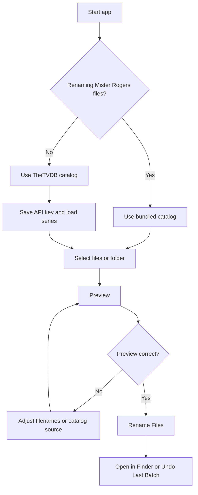

# Quick start (about 2 minutes)

## 1. Install Swift / Xcode

Use **Xcode 15+** (full app or Command Line Tools) on **macOS 12+**.

## 2. Build and run (double-clickable app)

**Recommended:** versioned output under **`build/Releases/`** (see [`build/Releases/README.md`](build/Releases/README.md)):

```bash
chmod +x ./Scripts/package_local_release.sh   # once
./Scripts/package_local_release.sh
open "build/Releases/1.0.0/macos-$(uname -m)/MisterRogersRenamer.app"
```

Use the **`MARKETING_VERSION`** folder that matches **`MacApp/MisterRogersRenamer.xcodeproj`** ([`CHANGELOG.md`](CHANGELOG.md) **1.0.0** for current release).

**One-off temp DerivedData:**

```bash
swift test
swift build -c release
DERIVED="$(mktemp -d)"
trap 'rm -rf "${DERIVED}"' EXIT
xcodebuild -project "MacApp/MisterRogersRenamer.xcodeproj" \
  -scheme MisterRogersRenamer \
  -configuration Release \
  -destination "platform=macOS" \
  -derivedDataPath "${DERIVED}" \
  build
open "${DERIVED}/Build/Products/Release/MisterRogersRenamer.app"
```

Or open **`MacApp/MisterRogersRenamer.xcodeproj`** in Xcode and press **⌘R**.

To copy the `.app` somewhere permanent:

```bash
cp -R "build/Releases/1.0.0/macos-$(uname -m)/MisterRogersRenamer.app" ~/Applications/
```

(or use **`DERIVED`** from the one-off build above.)

## 3. Use the app

1. Choose **Catalog source**: **Mister Rogers (bundled)** or **Any series (TheTVDB)**. For TheTVDB, save your v4 API key and **Load series** after entering an id or URL.
2. Click **Select Files** or **Select Folder** (toggle **Scan subfolders** if needed).
3. Click **Preview** — review original → new names (dry run; **no files change**).
4. Click **Rename Files** to apply.
5. Use **Open in Finder** or **Undo Last Batch** as needed.

**Tip:** Drag files or folders onto the dashed drop zone to add them to the selection.

## Quick decision path



## 5. Next steps

- Regenerate **bundled episodes** with [`Scripts/build_episodes_json.py`](Scripts/build_episodes_json.py) (needs `TVDB_API_KEY`; see [README.md](README.md)).
- For maintainers releasing tags, see [RELEASING.md](RELEASING.md) and [BUILD_GUIDE.md](BUILD_GUIDE.md).
